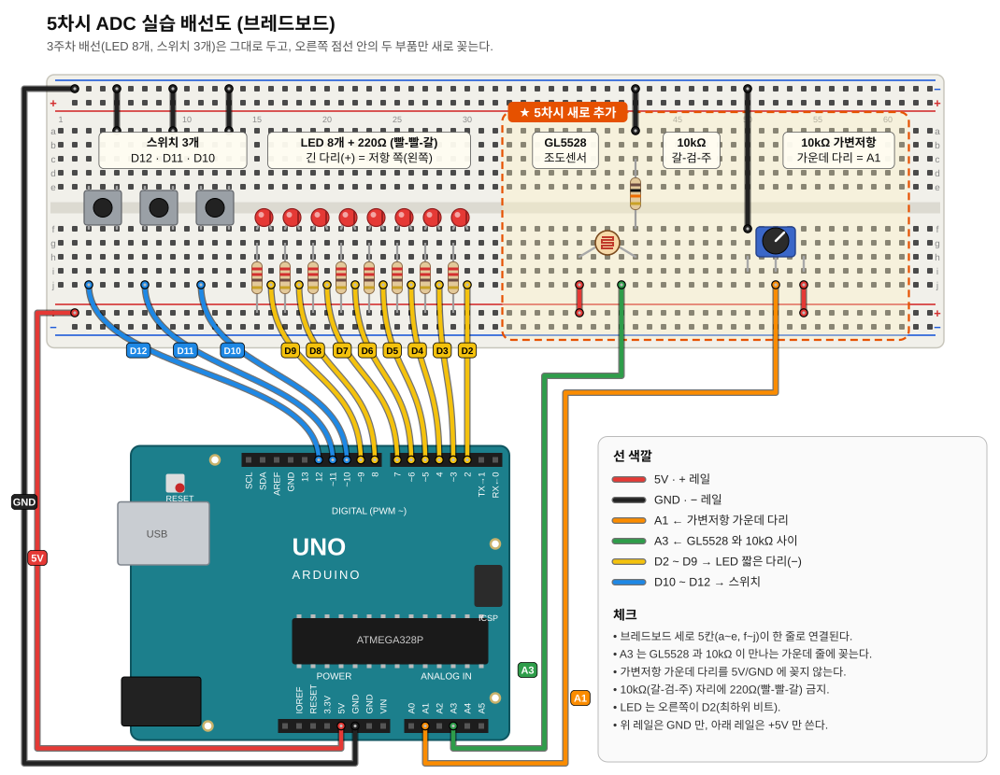
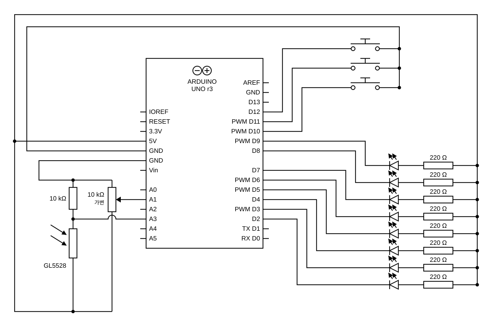

# 5차시 · ADC 와 아날로그 입력

ATmega328P 의 ADC(Analog to Digital Converter)로 가변저항과 조도센서(GL5528) 값을 읽는다.

| 폴더 | 내용 | PlatformIO env |
|---|---|---|
| `01_adc_print/` | 실습1 - 가변저항(A1) ADC 값 시리얼 출력 | `w04_adc_print` |
| `02_adc_led/` | 실습2 - ADC 값으로 LED 8단계 막대 그래프 | `w04_adc_led` |
| `03_cds_print/` | CdS 실습1 - 조도센서(A3) ADC / 전압 / 저항 출력 | `w04_cds_print` |
| `04_cds_led/` | CdS 실습2 - 어두우면 LED 전체 ON | `w04_cds_led` |

빌드/업로드 : `pio run -e w04_adc_print -t upload`, 모니터 : `pio device monitor`

---

## 0. 회로 (3주차 보드에 추가)

3주차 회로(LED D2 ~ D9 Active Low, 스위치 D10 ~ D12)는 그대로 두고 아래 두 개만 추가한다.



<details>
<summary>기호로 그린 회로도 보기</summary>



</details>

| 부품 | 아두이노 핀 | 포트/비트 | 연결 방법 |
|---|---|---|---|
| 10kΩ 가변저항 | A1 | PC1 / ADC1 | 한쪽 끝 → 5V, 반대쪽 끝 → GND, 가운데 다리 → A1 |
| GL5528 조도센서 | A3 | PC3 / ADC3 | 5V → GL5528 → A3 → 10kΩ → GND (밝을수록 값이 큼) |
| (기존) LED 8개 | D2 ~ D9 | PD2 ~ PD7, PB0 ~ PB1 | 5V → 220Ω → LED(+) → LED(−) → 핀, Active Low |
| (기존) 스위치 3개 | D10 ~ D12 | PB2 ~ PB4 | 핀 → 스위치 → GND, INPUT_PULLUP (이번 실습에서는 안 씀) |

배선 순서
1. 보드 5V → 브레드보드 아래 + 레일, GND → 위 − 레일 (3주차 배선에 이미 있으면 생략. 아래 레일은 +5V 만, 위 레일은 GND 만 쓴다)
2. 가변저항을 브레드보드에 꽂고 양 끝 다리를 + 레일, − 레일에 연결
3. 가변저항 가운데 다리 → A1
4. GL5528 한쪽 다리 → + 레일, 다른 쪽 다리를 빈 세로줄 X 에 꽂기
5. 10kΩ 저항 한쪽을 같은 줄 X 에, 다른 쪽을 − 레일에 연결
6. 줄 X → A3

주의할 점
- GL5528 과 10kΩ 이 만나는 **가운데 지점**에 A3 를 연결한다. GL5528 다리 양 끝 어느 쪽에 꽂아도 되지만(극성 없음), A3 가 5V 쪽이나 GND 쪽에 붙으면 값이 1023 / 0 으로 고정된다.
- 10kΩ(갈색-검정-주황)과 LED 용 220Ω(빨강-빨강-갈색)을 헷갈리지 않는다. 220Ω 을 쓰면 값 변화가 거의 없다.
- 가변저항 가운데 다리를 5V/GND 에 직접 꽂으면 끝까지 돌렸을 때 단락된다. 반드시 가운데 = A1.
- A1, A3 는 아날로그 핀 줄(보드 왼쪽 아래)에 있다. 디지털 핀 쪽과 헷갈리지 않는다.

## 1. ATmega328P ADC 특징 (데이터시트 24.1)

- **10비트 분해능** → 결과 0 ~ 1023
- 변환 시간 13 ~ 260 µs, 최대 76.9 kSPS (최대 분해능에서는 15 kSPS)
- 단일 입력 채널 6개 (TQFP/VQFN 패키지는 2개 더 → ADC6, ADC7)
- 온도 센서 입력 채널
- 결과 왼쪽 정렬(Left Adjust) 선택 가능
- 입력 전압 범위 0 ~ Vcc, 내부 1.1V 기준전압 선택 가능
- Free Running / Single Conversion 모드
- 변환 완료 인터럽트, Sleep Mode Noise Canceler

변환 결과 : `ADC = Vin × 1023 / Vref`  (Vref = 5V 이면 1 LSB ≈ 4.9 mV)

## 2. 레지스터

### ADMUX - ADC Multiplexer Selection Register (0x7C)

| 7 | 6 | 5 | 4 | 3 | 2 | 1 | 0 |
|---|---|---|---|---|---|---|---|
| REFS1 | REFS0 | ADLAR | – | MUX3 | MUX2 | MUX1 | MUX0 |

**REFS[1:0] - 기준전압 선택**

| REFS1 | REFS0 | 기준전압 |
|---|---|---|
| 0 | 0 | AREF 핀, 내부 Vref 꺼짐 |
| 0 | 1 | AVcc (AREF 핀에 외부 커패시터) ← 아두이노 기본 |
| 1 | 0 | 예약 |
| 1 | 1 | 내부 1.1V (AREF 핀에 외부 커패시터) |

- 변환 도중 바꾸면 그 변환이 끝난 뒤(ADIF set)에 적용된다.
- AREF 핀에 외부 전압을 넣고 있으면 내부 기준전압을 쓰면 안 된다.

**ADLAR - 결과 왼쪽 정렬.** 1 이면 왼쪽 정렬, 0 이면 오른쪽 정렬. 바꾸는 즉시 데이터 레지스터에 반영된다.

**MUX[3:0] - 입력 채널 선택**

| MUX3..0 | 입력 |
|---|---|
| 0000 ~ 0111 | ADC0 ~ ADC7 |
| 1000 | ADC8 (온도 센서) |
| 1001 ~ 1101 | 예약 |
| 1110 | 1.1V (V_BG) |
| 1111 | 0V (GND) |

UNO 의 A0 ~ A5 = PC0 ~ PC5 = ADC0 ~ ADC5. (A1 → ADC1, A3 → ADC3)

### ADCSRA - ADC Control and Status Register A (0x7A)

| 7 | 6 | 5 | 4 | 3 | 2 | 1 | 0 |
|---|---|---|---|---|---|---|---|
| ADEN | ADSC | ADATE | ADIF | ADIE | ADPS2 | ADPS1 | ADPS0 |

- **ADEN** : 1 이면 ADC 켜짐. 변환 중에 0 을 쓰면 변환이 중단된다.
- **ADSC** : 1 을 쓰면 변환 시작. 변환 중에는 1 로 읽히고 끝나면 0 으로 돌아간다.
  ADC 를 켠 뒤 첫 변환은 초기화 때문에 13 클럭이 아니라 25 클럭이 걸린다.
- **ADATE** : 자동 트리거. 트리거 소스는 ADCSRB 의 ADTS 비트로 고른다.
- **ADIF** : 변환이 끝나 데이터 레지스터가 갱신되면 1. 인터럽트 벡터가 실행되면 하드웨어가 지우고,
  직접 지우려면 1 을 쓴다. ADCSRA 를 Read-Modify-Write(SBI/CBI 포함)하면 대기 중인 인터럽트가 지워질 수 있으니 주의.
- **ADIE** : 1 이고 SREG 의 I 비트가 켜져 있으면 변환 완료 인터럽트 동작.
- **ADPS[2:0]** : 시스템 클럭 → ADC 클럭 분주비

| ADPS2..0 | 000 | 001 | 010 | 011 | 100 | 101 | 110 | 111 |
|---|---|---|---|---|---|---|---|---|
| 분주비 | 2 | 2 | 4 | 8 | 16 | 32 | 64 | 128 |

> 10비트 정확도를 내려면 ADC 클럭이 50 ~ 200 kHz 여야 한다. 16 MHz / 128 = 125 kHz 라서 아두이노는 128 분주를 쓴다.

### ADCL / ADCH - ADC Data Register (0x78 / 0x79)

- **ADLAR = 0** (오른쪽 정렬) : ADCH 에 ADC9..8, ADCL 에 ADC7..0
- **ADLAR = 1** (왼쪽 정렬) : ADCH 에 ADC9..2, ADCL 의 위 2비트에 ADC1..0
  → 8비트 정밀도로 충분하면 ADCH 만 읽으면 된다.
- 반드시 **ADCL 을 먼저** 읽고 ADCH 를 읽는다. (ADCL 을 읽는 순간 레지스터가 잠기고 ADCH 를 읽으면 풀린다)

### 레지스터로 직접 읽어 보기

`analogRead()` 가 안에서 하는 일은 대략 다음과 같다.

```cpp
ADMUX  = (1 << REFS0) | (ch & 0x0F);                 // AVcc 기준, 채널 선택
ADCSRA = (1 << ADEN) | (1 << ADPS2) | (1 << ADPS1) | (1 << ADPS0); // 켜기, 128 분주
ADCSRA |= (1 << ADSC);                               // 변환 시작
while (ADCSRA & (1 << ADSC));                        // 끝날 때까지 대기
int value = ADCL | (ADCH << 8);                      // ADCL 먼저
```

## 3. 가변저항 실습

### 회로

10 kΩ 가변저항 : 한쪽 끝 → 5V, 반대쪽 끝 → GND, 가운데 다리 → **A1 (PC1, ADC1)**

### 실습1 - ADC 결과 보기 (`01_adc_print`)

4차시에 만든 `Printf` 로 `analogRead(A1)` 값을 0.5초마다 출력한다.
가변저항을 돌릴 때 0 ~ 1023 이 나오면 성공.

### 실습2 - ADC 값을 LED 로 보기 (`02_adc_led`)

LED : +5V → 220Ω → LED → D2 ~ D9 (Active Low)

0 ~ 1023 을 128 씩 8칸으로 나눠, 켜지는 LED 개수를 1 ~ 8 로 바꾼다. (막대 그래프)

```
1단계 : XXXXXXXO      (0 ~ 127)
2단계 : XXXXXXOO      (128 ~ 255)
 ...
8단계 : OOOOOOOO      (896 ~ 1023)
```

`count = value / 128 + 1` 만큼 아래 비트부터 채운다. 반대로 돌리면 단계가 줄어든다.

## 4. GL5528 조도 센서 (CdS 광전도 셀)

- 황화카드뮴(CdS) 반도체 : **빛을 받으면 저항이 줄어드는** 소자
- LDR(Light Dependent Resistor), 포토레지스터라고도 부른다.
- 극성이 없어 방향 상관없이 꽂아도 된다.
- 빛이 들어오면 전류를 나르는 전하가 늘어나 저항이 내려간다.
  - 밝을 때 : 수 kΩ (저항 작음 → 전류 잘 흐름)
  - 어두울 때 : 1 MΩ 이상 (저항 큼 → 전류 거의 안 흐름)

### 전압 분배 회로

ADC 는 저항이 아니라 **전압**을 읽는다. 고정 저항과 직렬로 연결해 저항 변화를 전압 변화로 바꾼다.

```
5V ── GL5528 ──┬── 10kΩ ── GND
               │
              A3 (PC3, ADC3)
```

```
Vout  = 5V × 10k / (R_cds + 10k)
ADC   = Vout / 5V × 1023
R_cds = 10k × (1023 - ADC) / ADC     ← 거꾸로 풀면 저항을 구할 수 있다
```

- 밝을수록 R_cds 가 작아져 A3 전압이 올라간다. (**밝음 = 큰 값**)
  GL5528 과 10kΩ 의 자리를 바꾸면 반대로 어두울수록 커진다.
- **10kΩ 을 쓰는 이유** : 고정 저항이 측정하려는 밝기에서의 CdS 저항과 비슷할 때 전압이 가장 크게 변한다.
  실내(10 lux 근처)의 GL5528 은 약 8 ~ 20 kΩ 이므로 10kΩ 이 잘 맞는다.

### CdS 실습1 - 결과 보기 (`03_cds_print`)

ADC 값, 전압(mV), R_cds(Ω) 를 0.5초마다 출력한다. 손으로 가렸다 뗐다 하면서 값이 바뀌면 성공.

- 아두이노의 `vsnprintf` 는 `%f` 를 지원하지 않아 `?` 로 찍힌다. → mV 단위 **정수**로 계산한다.
- `ADC == 0` 이면 0 으로 나눌 수 없으므로 "too dark" 로 따로 처리한다.

### CdS 실습2 - 밝기에 따라 LED 제어 (`04_cds_led`)

- `ADC < THRESHOLD` → 어둡다 → LED 전체 ON
- `ADC >= THRESHOLD` → 밝다 → LED 전체 OFF
- THRESHOLD 는 실습1 에서 손으로 가렸을 때와 뗐을 때 값을 보고 그 중간쯤으로 정한다. (자료는 400)

## 5. 과제

조도센서로 **어두워질 때마다 카운트를 1씩 올리고**, 카운트를 LED 에 2진수로 표시한다.

- 회로 : 조도센서 5V → GL5528 → A3 → 10kΩ → GND, LED D2 ~ D9 (Active Low)
- 동작
  1. 밝은 상태 → 어두운 상태로 **바뀔 때** 카운트 +1. 계속 가리고 있는 동안에는 다시 올라가지 않는다. (상태 변화 = 에지 검출)
  2. 카운트를 LED 8개에 2진수로 표시한다. (D2 = 최하위 비트, 예: 5 → `0000 0101`)
  3. 255 를 넘으면 0 으로 돌아간다. (`byte` 오버플로)
  4. 카운트가 바뀔 때마다 시리얼 모니터에 출력한다.
- 힌트 : 이전 상태(밝음/어두움)를 변수에 저장해 두고, 밝음 → 어두움일 때만 센다.
  경계값 근처에서 값이 떨리면 여러 번 셀 수 있으니 THRESHOLD 를 두 개(히스테리시스) 쓰는 것을 고려한다.
