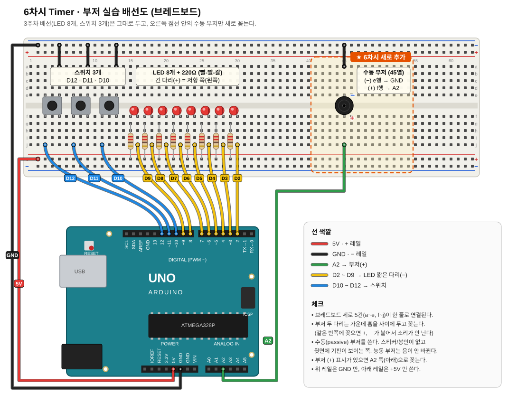

# 6차시 · Timer & 부저

ATmega328P 의 타이머로 정해진 주기마다 인터럽트를 내고, Timer1 CTC 모드로 부저 음을 낸다.

> 이번 차시는 과제 없음.

| 폴더 | 내용 | PlatformIO env |
|---|---|---|
| `01_normal_ovf/` | 예제 - Timer2 Normal 모드(오버플로)로 1초마다 LED 300ms 점등 | `w06_normal_ovf` |
| `02_ctc/` | 실습1 - 같은 기능을 CTC 모드(비교 일치)로 | `w06_ctc` |
| `03_buzzer/` | 예제 - Timer1 CTC 로 라(440Hz), SW1 Play / SW2 Stop | `w06_buzzer` |
| `04_scale/` | 실습2 - 음계 출력 (SW1 올림, SW2 내림, SW3 토글) | `w06_scale` |

빌드/업로드 : `pio run -e w06_ctc -t upload`, 모니터 : `pio device monitor`

---

## 0. 회로 (3주차 보드에 추가)

3주차 회로(LED D2 ~ D9 Active Low, 스위치 D10 ~ D12)는 그대로 두고 부저만 추가한다.
(5차시 가변저항 · 조도센서는 빼도 되고 그대로 둬도 된다. 이번 실습에서는 안 쓴다)



| 부품 | 아두이노 핀 | 포트/비트 | 연결 방법 |
|---|---|---|---|
| 수동 부저 | A2 | PC2 | A2 → 부저(+), 부저(−) → GND |
| (기존) LED 8개 | D2 ~ D9 | PD2 ~ PD7, PB0 ~ PB1 | 5V → 220Ω → LED → 핀, Active Low |
| (기존) 스위치 3개 | D10 ~ D12 | PB2 ~ PB4 | 핀 → 스위치 → GND, INPUT_PULLUP |

배선 순서
1. 부저를 브레드보드 **가운데 홈을 걸쳐서** 꽂는다. (−) 다리는 위쪽 e행, (+) 다리는 아래쪽 f행, 같은 세로줄(그림은 45열)
2. 같은 줄 a행 → 위 − 레일 (GND) 점퍼
3. 같은 줄 j행 → A2

- 두 다리를 같은 반쪽(a~e 또는 f~j)의 같은 줄에 꽂으면 +, − 가 붙어 소리가 안 난다.
- **수동(passive) 부저**여야 한다. 능동 부저는 전원만 주면 자기 주파수로 울려서 음 높이가 안 바뀐다.
- 자료와 다른 점
  - 자료는 Timer0 를 쓰지만 아두이노는 Timer0 를 `millis()` / `delay()` 용으로 쓰고 있어 ISR 중복 정의가 난다 → **Timer2** 사용.
  - 자료는 부저를 PB7(OC1C)에 연결하지만 그건 Mega 기준. UNO 의 OC1A(D9)·OC1B(D10)는 LED/스위치가 쓰고 있다 → **A2 를 비교 일치 ISR 에서 직접 토글**.
  - 자료는 외부 인터럽트 INT0/INT1(D2, D3)로 스위치를 받지만 D2, D3 은 LED → **PCINT0** 사용.

## 1. 타이머 계산

```
한 칸 시간       = 분주 / 클럭               (16MHz, 1024 분주 → 64us)
Normal 오버플로  = 분주 × (256 − TCNT시작값) / 클럭
CTC 주기         = 분주 × (1 + OCR) / 클럭
원하는 시간 → 칸 = 클럭 × t / 분주
```

16MHz 에서 분주별 최대 오버플로 주기

| 분주 | 1칸 | 8비트 (255) | 16비트 (65535) |
|---|---|---|---|
| 1 | 0.0625us | 0.016ms | 4ms |
| 8 | 0.5us | 0.128ms | 33ms |
| 64 | 4us | 1.02ms | 262ms |
| 256 | 16us | 4.08ms | 1,049ms |
| 1024 | 64us | 16.32ms | 4,194ms |

→ 8비트로는 1초를 한 번에 못 만든다. **5ms 인터럽트 × 200회 = 1초**, 60회 = 300ms 로 센다.

## 2. 레지스터 요약

| 레지스터 | 역할 |
|---|---|
| TCCRnA / TCCRnB | 모드(WGM), 출력 핀 동작(COM), 분주(CS) |
| TCNTn | 현재 카운트 값 |
| OCRnA / OCRnB | 비교 값 (CTC 에서는 TOP) |
| ICR1 | 16비트 Timer1 의 입력 캡처 / TOP 로도 사용 |
| TIMSKn | 인터럽트 허용 (TOIE = 오버플로, OCIEA = 비교 일치 A) |
| TIFRn | 인터럽트 플래그. **1 을 써야 지워진다** |

**8비트 타이머 모드 (WGM2:0)** : 0 Normal(TOP 0xFF) · 1 Phase Correct PWM · **2 CTC(TOP OCRA)** · 3 Fast PWM · 5 PC PWM(TOP OCRA) · 7 Fast PWM(TOP OCRA)

**16비트 Timer1 주요 모드 (WGM13:0)** : 0 Normal · **4 CTC(TOP OCR1A)** · **12 CTC(TOP ICR1)** · 14 Fast PWM(TOP ICR1) · 15 Fast PWM(TOP OCR1A)

**분주 (CSn2:0)** : 001 = 1, 010 = 8, 011 = 64, 100 = 256, 101 = 1024
※ Timer2 는 표가 다르다 : 1024 = `CS22 | CS21 | CS20` (111)

**COM 비트 (non-PWM)** : 00 끊김 · 01 토글 · 10 Clear · 11 Set

> 아두이노는 시작할 때 Timer0/1/2 를 PWM 용으로 설정해 둔다. TCCR 은 `|=` 가 아니라 **`=` 로 통째로 덮어쓴다.**

## 3. 예제 - Normal 모드 (`01_normal_ovf`)

- Timer2, 분주 1024, Normal 모드, `TIMSK2 = (1 << TOIE2)`
- `TCNT2 = 0xFF − 0x4E = 177` 에서 시작 → 79칸 × 64us ≈ 5ms 마다 `TIMER2_OVF_vect`
- Normal 모드는 0 부터 다시 세므로 **ISR 에서 매번 TCNT2 를 다시 넣는다.**
- 카운트 0 → 켬, 60 → 끔, 200 → 0 으로. (자료처럼 ISR 안에서 `delay` 쓰지 않는다)

## 4. 실습1 - CTC 모드 (`02_ctc`)

- `TCCR2A = (1 << WGM21)` → CTC, `OCR2A = 0x4E`, `TIMSK2 = (1 << OCIE2A)`
- `TIMER2_COMPA_vect` 사용. TCNT2 는 하드웨어가 0 으로 돌려주므로 ISR 에서 건드리지 않는다.
- 0 ~ 78 = 79칸 → 앞 예제와 같은 5ms.

## 5. 부저 예제 (`03_buzzer`)

```
부저 주파수 = 16MHz / (2 × 분주 × (1 + OCR1A))      분주 8
OCR1A       = 16MHz / (16 × 주파수) − 1
```

- ISR 두 번(High, Low)이 한 주기라서 2 를 곱한다.
- 라 440Hz → OCR1A = 2271 (자료 표의 2273 은 반올림 차이)
- `play()` 에서 `TCNT1 = 0` 을 하는 이유 : 새 OCR1A 보다 이미 커져 있으면 65535 까지 돌아서 한참 소리가 안 난다.

| 음 | 440 라 | 523 도 | 587 레 | 659 미 | 698 파 | 783 솔 | 880 라 | 1046 도 |
|---|---|---|---|---|---|---|---|---|
| OCR | 2273 | 1912 | 1704 | 1517 | 1433 | 1277 | 1136 | 956 |

## 6. 실습2 - 음계 출력 (`04_scale`)

- SW1 : 한 음 올림, SW2 : 한 음 내림, SW3 : 소리 켜기/끄기 토글
- LED : 꺼져 있으면 모두 꺼짐, 켜져 있으면 계이름 자리 하나 (도 = D2 … 시 = D8)
- '도'(C4) 부터 시작, 낼 수 있는 옥타브 끝까지 (C0 ~ B7)
- 힌트 배열 : `note_freq[7] = {2093, 2349, 2637, 2794, 3136, 3520, 3951}` (7옥타브)

풀이 방법

- 음 번호 = 옥타브 × 7 + 계이름 (C4 = 28, 범위 0 ~ 55)
- 한 옥타브 내려갈 때마다 주파수 절반 → `note_freq[deg] >> (7 − octave)`
- 가장 낮은 C0 = 16Hz → OCR1A = 62499 (16비트 안에 들어간다. 최저 약 15Hz)
- 시리얼 출력 예 : `C4   261 Hz  ON`
