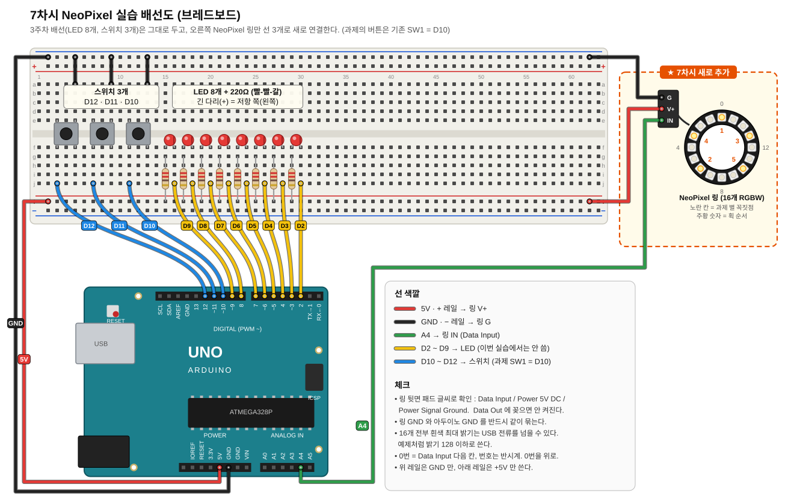

# 7차시 · NeoPixel (WS2812B RGBW 링)

Adafruit NeoPixel 라이브러리로 16개짜리 RGBW 링을 제어한다.

| 폴더 | 내용 | PlatformIO env |
|---|---|---|
| `01_blink/` | 예제1 - 0번 LED 하나 빨강 점멸 (330ms) | `w07_blink` |
| `02_rgbw/` | 예제2 - 0번 LED 를 R → G → B → W 반복 | `w07_rgbw` |
| `03_position/` | 예제3 - 원하는 위치(0, 4, 8, 12)에 LED 하나 | `w07_position` |
| `04_shift/` | 예제4 - 켜진 LED 하나가 0 → 15 로 100ms 마다 이동 | `w07_shift` |
| `05_brightness/` | 예제5 - 16개 초록색 밝기 0 → 240 → 0 | `w07_brightness` |
| `assignment/` | 과제 - 별 그리기 + 회전 + 버튼으로 속도 변경 | `w07_assignment` |

빌드/업로드 : `pio run -e w07_assignment -t upload`

---

## 0. 회로



| 링 패드 (뒷면 글씨) | 연결 | 비고 |
|---|---|---|
| Data Input (IN) | **A4** (PC4) | 자료 그림은 PB6 이지만 UNO 실습은 A4. 아날로그 핀도 디지털 출력 가능 |
| Power 5V DC (V+) | 5V (아래 + 레일) | 3.7 ~ 5.3V |
| Power Signal Ground (G) | GND (위 − 레일) | 아두이노 GND 와 반드시 공통 |
| (기존) SW1 | D10 (PB2) | 과제의 속도 버튼. INPUT_PULLUP |

- **Data Out** 패드에 꽂으면 안 켜진다. 반드시 Data Input.
- 16개 전부 흰색 최대 밝기면 수백 mA 라 USB 전원이 버거울 수 있다. 예제처럼 128 이하로 쓴다.
- 3주차 LED · 스위치 배선은 그대로 둬도 된다. (과제에서 SW1 사용)

## 1. 라이브러리

PlatformIO 는 `lib_deps` 에 적으면 빌드할 때 자동으로 받는다. 버전까지 고정한다.

```ini
lib_deps =
	adafruit/Adafruit NeoPixel@1.15.5
```

이 레포에서는 다른 주차 빌드에 영향이 없도록 `[neopixel]` 섹션에 한 번 적고 7차시 env 들만 `lib_deps = ${neopixel.lib_deps}` 로 가져다 쓴다.

```cpp
Adafruit_NeoPixel ring(16, A4, NEO_GRBW + NEO_KHZ800);

ring.begin();                              // 핀을 출력으로
ring.setPixelColor(i, ring.Color(R, G, B, W)); // 메모리에만 저장
ring.show();                               // 이때 실제로 링에 전송
ring.clear();                              // 전부 0 (show 해야 반영)
```

## 2. WS2812B 동작 원리

- 제어 회로 + LED 가 5050 패키지 하나에 들어 있다. 외부 부품(커패시터 포함) 없이 동작.
- 색 하나당 1 Byte (0 ~ 255). RGBW 는 픽셀 하나에 **32비트**.
- 보내는 순서는 **G → R → B → W, 각각 MSB 부터** (G7 … G0 R7 … R0 B7 … B0 W7 … W0).
  `NEO_GRBW` 를 주면 라이브러리가 순서를 맞춰 주므로 코드에서는 `Color(R, G, B, W)` 로 쓴다.
- 데이터 선 1개, **800 kbps** → 1비트 = TH + TL = 1.25 µs (±600 ns)

| 코드 | High | Low |
|---|---|---|
| 0 | T0H 0.35 µs | T0L 0.8 µs |
| 1 | T1H 0.7 µs | T1L 0.6 µs |
| RESET | – | 50 µs 이상 Low (자료 그림은 ≥ 80 µs) |

  → 0 과 1 을 **High 길이**로 구분한다. 오차 ±150 ns 로 빡빡하고 UART 같은 전용 하드웨어도 없어서
  라이브러리가 어셈블리로 클럭을 세며 비트를 만든다. (그동안 인터럽트가 잠깐 꺼진다)

### Cascade (직렬 연결)

```
MCU ─D1→ [PIX1] ─D2→ [PIX2] ─D3→ [PIX3] ─D4→ ...
```

- 각 픽셀은 **처음 들어온 32비트를 자기 것으로 가져가고**, 나머지는 파형을 다시 만들어 DOUT 으로 넘긴다.
- 그래서 MCU 는 0번, 1번, 2번 … 순서로 이어서 보내기만 하면 된다. 다 보낸 뒤 RESET(Low 유지)을 주면 한 번에 표시된다.
- 0번 LED = Data Input 바로 다음 칸.

## 3. 예제

| 예제 | 핵심 |
|---|---|
| 1 | `setPixelColor(0, color)` 후 `show()`, 끌 때 `clear()` + `show()` |
| 2 | `Color(128,0,0,0)` 빨강, `(0,128,0,0)` 초록, `(0,0,128,0)` 파랑, `(0,0,0,128)` 흰색(W 칸) |
| 3 | `led_on(color, index)` : index 번만 켜고 나머지는 0 |
| 4 | j = 0 ~ 15 로 켜는 위치를 옮기며 `show()` + `delay(100)` |
| 5 | 16개 전부 같은 색, 초록 값을 0 → 240 → 0 (10 씩, 40ms) |

## 4. 과제 (`assignment`)

> NeoPixel 링 Data in = A4.
> 링에 별 꼭짓점 5개를 정해 획 순서대로 하나씩 켜기 → 다 그려지면 한 칸씩 돌려 한 바퀴 회전 → 반복.
> 버튼을 누를 때마다 속도 변경 : 중간(시작) → 빠르게 → 느리게 → 중간.
> 제출 : LMS 에 코드 제출

```
        1
   4         3
     2     5
```

풀이

- 16칸 ÷ 5 = 3.2 → 꼭짓점을 **3, 3, 4, 3, 3** 칸 간격으로 잡는다.
- 링 번호는 앞에서 볼 때 **반시계 방향**으로 늘어난다. (실제 링에서 확인. 시계 방향으로 가정하면 별이 좌우로 뒤집힌다)
  위 0, 왼쪽 3, 왼쪽 아래 6, 오른쪽 아래 10, 오른쪽 13.
- 별은 꼭짓점을 하나씩 건너뛰며 긋는다 → 획 순서 `{0, 6, 13, 3, 10}` (= 그림의 1 ~ 5)
- 회전 : 모든 꼭짓점에 `(star[i] + offset) % 16`. offset 0 ~ 15 로 16단계 돌면 한 바퀴.
- 속도 : 한 단계 시간 중간 200ms → 빠르게 80ms → 느리게 400ms.
- `delay()` 로 기다리면 그동안 버튼을 못 읽는다 → `millis()` 로 "다음 단계 시각" 만 확인하고
  `loop` 는 계속 돌며 버튼(SW1 = D10)의 눌리는 순간(HIGH → LOW)만 센다.
- 0번(Data Input 바로 다음 칸)이 위로 오게 링을 놓는다.
