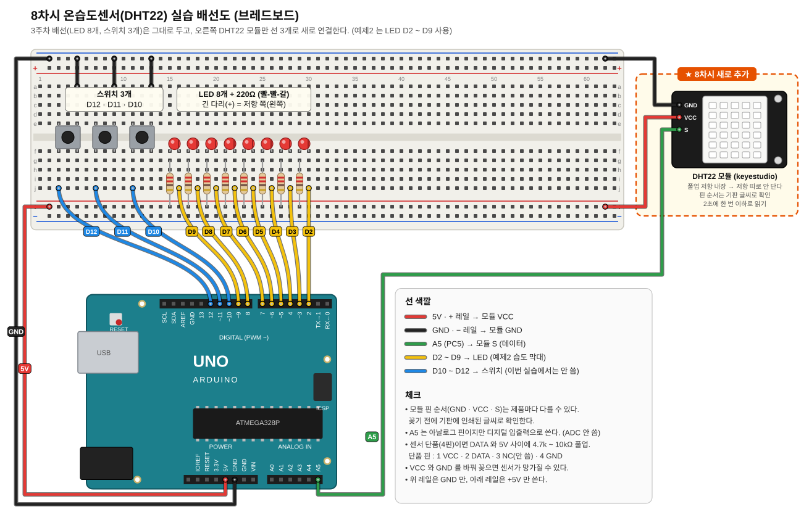

# 8차시 · 온습도센서 (DHT22)

온도와 습도를 함께 재서 **디지털 값(40비트)** 으로 보내 주는 센서. 데이터 선 하나로 주고받는다.

| 폴더 | 내용 | PlatformIO env |
|---|---|---|
| `01_print/` | 예제1 - 습도, 온도를 2초마다 시리얼 출력 | `w08_print` |
| `02_humidity_bar/` | 예제2 - 습도 0 ~ 100% 를 LED 0 ~ 8개로 (12.5% 마다 1개) | `w08_bar` |
| `03_raw/` | 추가 - 라이브러리 없이 통신 과정을 직접 구현. 받은 5바이트도 출력 | `w08_raw` |

빌드/업로드 : `pio run -e w08_print -t upload`  (시리얼 9600)

---

## 0. 회로



| 모듈 핀 (핀 쪽에서 볼 때 GND · VCC · S) | 연결 | 비고 |
|---|---|---|
| S (데이터) | **A5** (PC5) | 아날로그 핀이지만 디지털 입출력으로 쓴다 |
| VCC | 5V | 3.3 ~ 6V |
| GND | GND | |
| (기존) LED | D2 ~ D9 | 예제2. Active Low |

- 모듈 기판에 **풀업 저항이 있어서** 따로 달지 않는다.
- 센서 단품(4핀)을 쓸 때는 DATA 와 5V 사이에 4.7k ~ 10kΩ 풀업을 단다. 단품 핀 : 1 VCC, 2 DATA, 3 NC, 4 GND.

## 1. 사양

| 항목 | 내용 |
|---|---|
| 온도 | -40 ~ 80℃, ±0.5℃ |
| 습도 | 0 ~ 100%RH, ±2%RH |
| 분해능 | 0.1℃ / 0.1%RH |
| 측정 간격 | **2초 이상** (더 자주 읽으면 안 된다) |

센서 안에 습도 소자 · 온도 소자 · 8비트 MCU 가 있어서 측정값을 보정하고 숫자로 바꿔 보낸다.
→ CdS(5차시)처럼 전압을 보내는 게 아니라서 **ADC 가 필요 없다**.

## 2. 라이브러리

```ini
lib_deps =
	adafruit/DHT sensor library@1.4.6
	adafruit/Adafruit Unified Sensor@1.1.15
```

이 레포에서는 `[dht]` 섹션에 한 번 적고 8차시 env 들만 `lib_deps = ${dht.lib_deps}` 로 쓴다.

```cpp
DHT dht(A5, DHT22);
dht.begin();
float h = dht.readHumidity();     // %
float t = dht.readTemperature();  // ℃
if (isnan(h) || isnan(t)) { ... } // 실패하면 NAN
```

## 3. Single-Bus 통신

```
     ① 시작 (MCU)        ② 응답 (센서)      ③ 데이터 40비트            ④ 종료
‾‾‾‾‾\__________/‾‾‾‾‾\________/‾‾‾‾‾‾‾\____/‾‾\____/‾‾‾‾‾‾\ ... \____/‾‾‾‾
      LOW ≥1ms   20~40us  LOW 80us HIGH 80us   비트 0      비트 1       LOW 50us
```

| 구간 | 만드는 쪽 | 시간 |
|---|---|---|
| 시작 신호 LOW | MCU | 1ms 이상 |
| 시작 후 HIGH | MCU (놓으면 풀업이 올림) | 20 ~ 40us |
| 응답 LOW | 센서 | 80us |
| 응답 HIGH | 센서 | 80us |
| 비트 앞 LOW | 센서 | 50us |
| 비트 0 HIGH | 센서 | 26 ~ 28us |
| 비트 1 HIGH | 센서 | 70us |
| 종료 LOW | 센서 | 50us |

- **LOW 는 항상 50us, HIGH 가 짧으면 0, 길면 1.** (`03_raw` 는 40us 를 기준으로 가른다)
- 선 하나를 MCU 와 센서가 번갈아 쓴다 → MCU 는 시작 신호를 보낸 뒤 핀을 **입력으로 바꿔서 놓는다**.

## 4. 데이터 (40비트 = 5바이트, MSB 부터)

| [0] | [1] | [2] | [3] | [4] |
|---|---|---|---|---|
| 습도 상위 | 습도 하위 | 온도 상위 | 온도 하위 | 체크섬 |

- 습도 = 16비트 값 ÷ 10 (%RH)
- 온도 = 아래 15비트 값 ÷ 10 (℃), **bit15 = 1 이면 영하**
- 체크섬 = [0] + [1] + [2] + [3] 의 하위 8비트. 다르면 버리고 다시 측정

### 해석 예시

```
0x02 0x8C 0x01 0x5F 0xEE
습도   0x028C = 652 → 65.2 %RH
온도   0x015F = 351 → 35.1 ℃
체크섬 0x02 + 0x8C + 0x01 + 0x5F = 0xEE → 같음 (정상)

영하 : 온도 0x80 0x65 → bit15 = 1, 0x0065 = 101 → -10.1 ℃
```

```cpp
int humi = (data[0] << 8) | data[1];
int temp = ((data[2] & 0x7F) << 8) | data[3];
if (data[2] & 0x80) temp = -temp;
```

## 5. 예제

| 예제 | 핵심 |
|---|---|
| 1 | `delay(2000)` → `readHumidity()`, `readTemperature()` → `isnan` 검사 → `print(값, 1)` |
| 2 | `n = (int)(humi / 12.5)` (8 넘으면 8) → `led_bar(n)` : i < n 이면 LOW(켜기) |
| 3 | 시작 신호 → 응답 대기 → 비트마다 HIGH 길이 재기 → 5바이트 조립 → 체크섬 |
