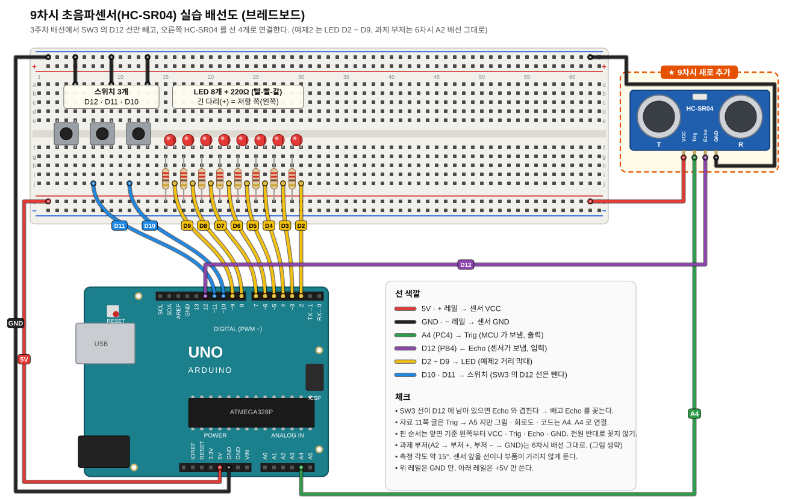

# 9차시 · 초음파센서 (HC-SR04)

초음파를 보내고 **돌아오는 시간**으로 거리를 잰다. 거리를 Echo 핀의 **HIGH 시간(펄스 폭)** 으로 알려 준다.
라이브러리는 필요 없다. (`pulseIn()` 은 Arduino 기본 함수)

| 폴더 | 내용 | PlatformIO env |
|---|---|---|
| `01_print/` | 예제1 - Echo 시간(us)과 거리(cm)를 시리얼 출력 (200ms 간격) | `w09_print` |
| `02_led_bar/` | 예제2 - 가까울수록 LED 많이. 5cm 마다 1개, 40cm 이상 0개 | `w09_bar` |
| `assignment/` | 과제 - A2 부저 주차 경보기 | `w09_assignment` |

빌드/업로드 : `pio run -e w09_print -t upload`  (시리얼 9600)

---

## 0. 회로



| 센서 핀 | 연결 | 방향 | 비고 |
|---|---|---|---|
| VCC | 5V | | 5V 전용 |
| Trig | **A4** (PC4) | 출력 (MCU → 센서) | 아날로그 핀이지만 디지털 출력으로 쓴다 |
| Echo | **D12** (PB4) | 입력 (센서 → MCU) | |
| GND | GND | | |
| (기존) LED | D2 ~ D9 | | 예제2. Active Low |
| (6차시) 부저 | A2 (PC2) | | 과제. 수동 부저 |

- 핀 순서는 앞면 기준 왼쪽부터 **VCC · Trig · Echo · GND**.
- 자료 11쪽 글에는 `Trig → A5` 로 적혀 있지만 같은 쪽 그림, 12쪽 회로도, 예제 코드는 모두 **A4**. A4 로 연결한다.
- 3주차 배선에서 **SW3 가 D12** 를 쓴다. 선을 그대로 두면 Echo 와 겹치므로 SW3 의 D12 선은 빼고 그 자리에 Echo 를 꽂는다.

## 1. 사양

| 항목 | 내용 |
|---|---|
| 전원 / 전류 | 5V DC / 15mA |
| 초음파 주파수 | 40kHz (사람은 20kHz 이상을 못 듣는다) |
| 측정 거리 | 2cm ~ 400cm |
| 측정 각도 | 약 15° |
| 분해능 | 약 0.3cm |
| Trig 입력 | 10us 이상의 HIGH 펄스 |
| Echo 출력 | 거리에 비례하는 HIGH 펄스 |

## 2. 동작 순서 (Timing Diagram)

```
Trig  __|‾‾‾‾|________________________________________   ① MCU 가 10us 이상 HIGH
          10us
발사  ________||||||||_______________________________    ② 센서가 40kHz 초음파 8번
Echo  ________________|‾‾‾‾‾‾‾‾‾‾‾‾‾‾‾‾‾‾‾‾‾|_________   ③ HIGH 인 시간 t = 왕복 시간
                      발사 끝나면 HIGH       반사파 오면 LOW
```

```cpp
digitalWrite(TRIG_PIN, LOW);  delayMicroseconds(2);   // 깨끗한 LOW 에서 시작
digitalWrite(TRIG_PIN, HIGH); delayMicroseconds(10);  // ① 10us HIGH
digitalWrite(TRIG_PIN, LOW);
unsigned long t = pulseIn(ECHO_PIN, HIGH, 25000);     // ③ HIGH 시간 (us), 시간 초과면 0
```

- `pulseIn(핀, HIGH, 제한시간)` : 핀이 HIGH 인 시간을 us 로 돌려준다. 제한시간 안에 안 끝나면 **0**.
- 제한시간 25000us ≈ 4.3m. 이보다 길면 범위 밖으로 보고 포기한다.
- 측정 간격은 **60ms 이상** (앞 측정의 반사파가 다음 측정에 섞이지 않게).

## 3. 거리 계산

```
거리 = 음속 × 시간 ÷ 2        ÷ 2 : 갔다가 돌아온 왕복 시간이라서
음속 340 m/s = 0.034 cm/us
거리(cm) = t × 0.034 ÷ 2 ≈ t ÷ 58      58us = 1cm 를 왕복하는 시간 (1 ÷ 0.034 × 2)
```

| Echo HIGH 시간 | 거리 |
|---|---|
| 116us | 2cm |
| 580us | 10cm |
| 2,900us | 50cm |
| 5,800us | 1m |
| 23,200us | 4m |

### 음속과 온도

음속(m/s) ≈ 331.5 + 0.6 × 온도(℃)

| 온도 | 음속 | t = 5,800us 일 때 |
|---|---|---|
| 0℃ | 331.5 m/s | 96.1cm |
| 20℃ | 343.5 m/s | 99.6cm |
| 30℃ | 349.5 m/s | 101.4cm |

같은 Echo 시간이라도 온도에 따라 수 cm 달라진다. 8차시 DHT22 로 온도를 재면 보정할 수 있다.
`거리(cm) = t × (331.5 + 0.6 × 온도) / 10000 / 2`

### 잘 안 재지는 경우

- 부드러운 물체 (천, 스펀지) : 소리를 흡수한다
- 비스듬한 면 : 반사파가 다른 방향으로 튕겨 나간다
- 2cm 미만, 4m 초과

## 4. 예제

| 예제 | 핵심 |
|---|---|
| 1 | Trig 10us → `pulseIn` → `t == 0` 이면 out of range, 아니면 `t / 58.0` 출력 |
| 2 | `read_distance()` (범위 밖 -1) → `d < 40` 이면 `n = 8 - (int)(d / 5)` → `led_bar(n)` |

## 5. 과제 (`assignment`)

> A2 부저를 사용하여 주차 경보기 만들기. 30cm 보다 멀면 조용하고,
> 10 ~ 30cm 는 가까울수록 빨리 삑삑, 10cm 미만은 계속 울림.
> 회로도 X, 코드만 제출.

| 거리 | 부저 |
|---|---|
| 측정 실패 / 30cm 초과 | 조용 |
| 10 ~ 30cm | 60ms 삑, 주기 = 거리 × 20ms (10cm → 200ms, 30cm → 600ms) |
| 10cm 미만 | 계속 |

풀이

- 소리 : 6차시 `03_buzzer` 와 같은 방법. **Timer1 CTC 비교 일치 ISR 에서 A2 를 뒤집는다**. 1kHz → `OCR1A = 16MHz / (16 × 1000) − 1 = 999`.
  `sound_on()` / `sound_off()` 는 `OCIE1A` 를 켜고 끄기만 한다. 이미 울리는 중이면 다시 건드리지 않는다. (TCNT1 을 계속 0 으로 만들면 소리가 찌그러진다)
- 박자 : `delay()` 로 삑삑을 만들면 그동안 거리를 못 잰다. `millis()` 로 "이번 삑이 언제 시작됐나" 만 기억하고
  `now - beep_start` 가 60ms 보다 작으면 켜고, 주기를 넘으면 새 삑을 시작한다. `loop` 는 멈추지 않는다.
- 측정 : 60ms 마다 한 번 (센서 측정 간격 60ms 이상).
- 참고 : `pulseIn` 은 반복문 횟수로 시간을 세서, 부저 ISR 이 끼어든 시간은 빠진다. 1kHz 토글(초당 2000번, 한 번에 몇 us)이면 오차 1% 미만이라 무시한다.
