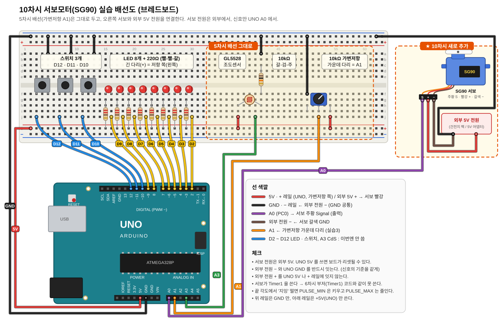

# 10차시 · 서보모터 (SG90)

원하는 각도로 돌아가서 **그 자리에 멈추는** 모터. 각도를 **펄스 폭**으로 알려 주면 스스로 맞춘다.
라이브러리 없이 Timer1 로 펄스를 직접 만든다.

| 폴더 | 내용 | PlatformIO env |
|---|---|---|
| `01_pulse/` | 실습1 - 0° → 90° → 180° → 90° 를 1초씩. `micros()` 로 펄스를 직접 만든다 | `w10_pulse` |
| `02_sweep/` | 실습2 - 0° ↔ 180° 를 1° 씩 왕복. 펄스는 Timer1 인터럽트가 만든다 | `w10_sweep` |
| `03_pot/` | 실습3 - 가변저항(A1)으로 서보 위치 제어 | `w10_pot` |

빌드/업로드 : `pio run -e w10_sweep -t upload`  (시리얼 9600)

---

## 0. 회로



| 서보 선 | 연결 | 비고 |
|---|---|---|
| 주황 Signal | **A0** (PC0) | 출력 (MCU → 서보). 아날로그 핀이지만 디지털 출력으로 쓴다 |
| 빨강 V+ | **외부 5V (+)** | UNO 5V 에 잇지 않는다 |
| 갈색 GND | **외부 전원 GND 와 UNO GND 모두** | GND 공통 |
| (5차시) 가변저항 | A1 (PC1) | 실습3. 가운데 다리 → A1, 양 끝 → 5V / GND |

### 외부 전원을 쓰는 이유

- USB 로 받는 5V 는 PC 와 보드가 함께 쓴다.
- 서보는 움직이기 시작할 때와 막혀서 버틸 때 전류가 크게 늘어난다 → 5V 가 순간적으로 떨어진다 → **보드 리셋, 서보 떨림, 오동작**.
- 그래서 서보 전원은 외부에서, 신호만 UNO 에서. **GND 를 이어야 신호의 기준이 같아진다.**

## 1. 사양

| 항목 | 내용 |
|---|---|
| 동작 전압 | 4.8 ~ 6V (실습은 5V) |
| 회전 범위 | 약 180° |
| 토크 | 1.8 kgf·cm (4.8V) : 축에서 1cm 떨어진 곳의 1.8kg 을 든다 |
| 속도 | 0.1초 / 60° (4.8V) |
| 제어 신호 | PWM, 주기 **20ms (50Hz)** |
| 펄스 폭 | 약 0.5 ~ 2.4ms → 0 ~ 180° |
| 데드 밴드 | 10us : 펄스 폭이 10us 보다 적게 바뀌면 움직이지 않는다 |

### DC 모터와 차이

| | DC 모터 | 서보모터 |
|---|---|---|
| 회전 | 전원을 주면 계속 돈다 | 정해진 각도까지만 돈다 |
| 제어하는 것 | 속도, 방향 | 각도 (위치) |
| 현재 위치 | 모른다 | 내부 가변저항으로 안다 |

### 내부 구조와 위치 제어

모터 + 기어 + **가변저항(위치 센서)** + 제어 회로가 한 몸에 들어 있다. 그래서 MCU 는 각도만 알려 주면 된다.

```
제어 신호 ──→ 제어 회로 ──→ DC 모터 ──→ 기어 ──→ 출력축
(펄스 폭 = 목표 각도)  ↑ 목표와 현재 비교    (속도↓ 힘↑)    │
                       └──────── 가변저항 (현재 각도) ←──┘
```

1. 제어 회로가 펄스 폭을 보고 **목표 각도**를 안다
2. 가변저항으로 **현재 각도**를 안다
3. 차이가 있으면 줄어드는 쪽으로 모터를 돌린다
4. 같아지면 멈춘다. 밖에서 밀어도 다시 돌아온다

## 2. 제어 신호

```
    ┌─┐                              ┌─┐
────┘ └──────────────────────────────┘ └───   펄스 폭 0.5ms →   0°
    ┌──┐                             ┌──┐
────┘  └─────────────────────────────┘  └──   펄스 폭 1.45ms →  90°
    ┌───┐                            ┌───┐
────┘   └────────────────────────────┘   └─   펄스 폭 2.4ms  → 180°
    ←──────────── 주기 20ms ──────────→
```

**주기는 항상 20ms. HIGH 인 시간(펄스 폭)만 바꿔서 각도를 정한다.**

| 각도 | 펄스 폭 |
|---|---|
| 0° | 0.5ms |
| 45° | 약 0.98ms |
| 90° | 약 1.45ms |
| 135° | 약 1.93ms |
| 180° | 2.4ms |

```
펄스 폭 (ms) = 0.5 + 각도 × 1.9 ÷ 180          (SG90 기준)
펄스 폭 (us) = 500 + 각도 × 1900 / 180
```

- 일반 규격은 1 ~ 2ms 지만 SG90 은 0.5 ~ 2.4ms 를 많이 쓴다. 범위는 제품마다 조금씩 다르다.
- 끝 각도에서 '지잉' 소리가 나며 떨면 범위를 줄인다 (`PULSE_MIN` 키우기, `PULSE_MAX` 줄이기).

## 3. 펄스를 만드는 방법

| | 하드웨어 PWM | 타이머 인터럽트 (이번 실습) |
|---|---|---|
| 방법 | 타이머가 핀 출력을 직접 바꾼다 | 비교 일치 ISR 에서 핀을 HIGH / LOW |
| 핀 | Timer1 → D9 (OC1A), D10 (OC1B) 만 | 아무 디지털 핀 |
| CPU | 설정 후 할 일 없음 | ISR 이 잠깐씩 |
| 우리 보드 | D9 = LED, D10 = SW1 이라 못 씀 | **A0** 사용. Servo 라이브러리도 이 방식 |

- `analogWrite()` 기본 PWM 은 약 490Hz / 980Hz (주기 1 ~ 2ms) → 20ms 주기가 필요한 서보에는 안 맞는다.
- Servo 라이브러리도 Timer1 을 차지한다 → D9, D10 의 PWM 출력을 못 쓴다.
- **6차시 부저 코드도 Timer1 을 쓰므로 같이 쓸 수 없다.**

## 4. 실습

### 실습1 (`01_pulse`) - 펄스를 직접

```cpp
unsigned long start = micros();
digitalWrite(SERVO_PIN, HIGH);
while (micros() - start < pulse_us) {}  // 펄스 폭만큼 HIGH
digitalWrite(SERVO_PIN, LOW);
while (micros() - start < 20000) {}     // 20ms 가 될 때까지 LOW
```

- `delayMicroseconds()` 는 인터럽트가 끼어든 만큼 길어진다 → `micros()` 로 시작 시각부터 잰다.
- 서보는 펄스가 계속 와야 자리를 지킨다 → `hold_1sec()` 가 20ms × 50번 = 1초 동안 보낸다.
- 단점 : 펄스를 만드는 동안 CPU 가 다른 일을 못 한다.

### 실습2 (`02_sweep`) - Timer1 인터럽트

```
Timer1 CTC, 8분주 → 1칸 = 0.5us
20ms = 40000칸 → OCR1A = 39999

TCNT1 : 0 ──────→ OCR1B ──────────────────→ 39999 → 0 ...
        COMPA      COMPB
        A0 = HIGH  A0 = LOW
        ←─펄스 폭─→
```

```cpp
ISR(TIMER1_COMPA_vect) { PORTC |= (1 << PORTC0); OCR1B = pulse_ticks; } // 20ms 마다 시작
ISR(TIMER1_COMPB_vect) { PORTC &= ~(1 << PORTC0); }                     // 펄스 폭 뒤 끝

TCCR1A = 0;                             // OC1A/OC1B 핀 출력 안 씀
TCCR1B = (1 << WGM12) | (1 << CS11);    // CTC (TOP = OCR1A), 8분주
OCR1A  = 39999;                         // 20ms
TIMSK1 = (1 << OCIE1A) | (1 << OCIE1B); // 비교 일치 A, B 인터럽트
```

- `servo_write(angle)` : `us = 500 + (long)angle × 1900 / 180` → `pulse_ticks = us × 2` (1us = 2칸).
  - `angle × 1900` 은 최대 342000 이라 int(최대 32767)를 넘는다 → **long** 으로 계산.
  - `pulse_ticks` 는 2바이트라 쓰는 도중 ISR 이 읽으면 값이 깨질 수 있다 → `noInterrupts()` 로 감싼다.
- `OCR1B` 는 COMPA ISR 에서 매 주기 시작할 때 바꾼다 → 펄스 도중에 값이 바뀌지 않는다.
- `loop()` 는 각도만 정한다. `STEP_MS = 20` (1° 움직이는 시간, 크게 하면 느려진다).

### 실습3 (`03_pot`) - 가변저항으로 위치 제어

```
가변저항 0 ~ 5V → ADC 0 ~ 1023 → 각도 0 ~ 180°
angle = (adc × 180 + 511) / 1023      (+ 511 은 반올림)
```

떨림 줄이기

1. ADC 를 **8번 읽어 평균** (`(sum + 4) / 8`, + 4 는 반올림)
2. 각도가 **2° 이상 바뀔 때만** 서보를 움직인다 (양 끝 0°, 180° 는 바로)

- `setup()` 에서 `servo_write()` 로 가변저항 위치 각도를 먼저 정한 뒤 `servo_begin()` → 켜자마자 엉뚱한 각도로 튀지 않는다.
- 출력은 `millis()` 로 200ms 마다, `loop` 는 `delay(20)` (서보 주기와 같게).

## 5. 과제

10차시 자료에는 과제 페이지가 없다. (실습 1 ~ 3 까지)
