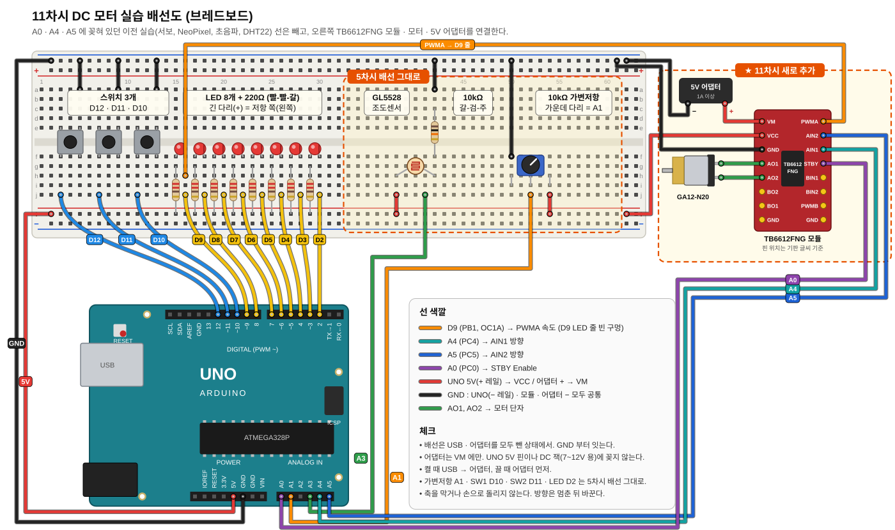

# 11차시 · DC 모터 (GA12-N20 + TB6612FNG)

DC 모터에 감속 기어박스를 붙인 **GA12-N20 기어드모터**를 모터 드라이버 **TB6612FNG** 로 돌린다.
전압의 **방향**으로 회전 방향을, 전압의 **크기(PWM 듀티)** 로 속도를 바꾼다. 라이브러리는 쓰지 않는다.

| 폴더 | 내용 | PlatformIO env |
|---|---|---|
| `01_direction/` | 실습1 - 정회전 2초 → 정지 1초 → 역회전 2초 → 정지 1초 | `w11_direction` |
| `02_stop_modes/` | 실습2 - 3초씩 돌린 뒤 브레이크, 정지, 대기를 차례로 | `w11_stop_modes` |
| `03_pwm_rpm/` | 실습3 - 듀티 25/50/75/100%, D2 LED 가 켜진 5초 동안 바퀴 수 × 12 = RPM | `w11_pwm_rpm` |

빌드/업로드 : `pio run -e w11_direction -t upload`  (시리얼 9600)

---

## 0. 회로



| TB6612 | 연결 | AVR | 역할 |
|---|---|---|---|
| PWMA | **D9** | PB1 (OC1A) | 속도, PWM 출력 |
| AIN1 | **A4** | PC4 | 방향, 디지털 출력 |
| AIN2 | **A5** | PC5 | 방향, 디지털 출력 |
| STBY | **A0** | PC0 | Enable, 디지털 출력 |
| VCC | UNO 5V | - | 논리 전원 |
| GND | UNO GND | - | 어댑터 GND 와 공통 |
| VM | 어댑터 + | - | 모터 전원 |
| AO1, AO2 | 모터 단자 | - | 모터 출력 |

| 보드 부품 | 연결 | AVR | 역할 |
|---|---|---|---|
| 가변저항 | A1 | PC1 (ADC1) | 속도 입력 |
| SW1 | D10 | PB2 | 방향 전환 |
| SW2 | D11 | PB3 | 정지 |

- A0, A4, A5 는 이전 실습(서보, NeoPixel, 초음파, DHT22) 선을 **빼고** 쓴다.
- D9 에는 3주차 LED 가 그대로 붙어 있다. PWMA 선은 D9 LED 줄의 빈 구멍에 꽂는다. LED 는 Active Low 라서 **듀티가 클수록 어두워진다**.
- TB6612 모듈 핀 순서는 제조사마다 다르다. **반드시 기판에 인쇄된 이름**을 보고 연결한다.
- 입력 핀은 칩 안에 200kΩ 풀다운이 있어 연결하지 않으면 L. (BIN1, BIN2, PWMB 는 안 씀)

### 배선 순서

1. **전원 분리** : USB 와 어댑터를 모두 뺀다
2. **GND** : UNO, 모듈, 어댑터의 GND 를 먼저 잇는다
3. **제어선** : PWMA D9, AIN1 A4, AIN2 A5, STBY A0, VCC 5V
4. **모터** : AO1, AO2 에 잇는다. 축에는 아무것도 닿지 않게
5. **모터 전원** : VM 에 어댑터 + 를 잇고 극성을 다시 확인
6. **전원 투입** : USB → 어댑터 순서. 끌 때는 어댑터부터

### 전원 구성

```
PC USB ─→ UNO ─ 5V ──→ VCC  (칩의 논리 전원)
               └ GND ─→ GND ┐
                             ├ 모듈 안에서 연결
5V 어댑터 ─ + ──────→ VM   (모터 전원)
           └ − ──────→ GND ┘
```

- **어댑터 GND 와 UNO GND 는 반드시 공통.**
- UNO 5V 핀으로 모터를 돌리지 않는다.
- 5V 어댑터를 UNO 의 DC 잭에 꽂지 않는다 (DC 잭은 7 ~ 12V 용).

## 1. GA12-N20 기어드모터

GA12 : 12mm 급 기어박스, N20 : 소형 DC 모터 규격. **6V · 50RPM**.

| 항목 | 값 | 근거 |
|---|---|---|
| 정격 전압 | 6V DC | 실습 제품 표기 |
| 무부하 속도 | 50RPM (6V) | 실습 제품 표기 |
| 감속비 | 약 298 : 1 | 동급 참고 |
| 무부하 전류 | 약 40mA | 동급 참고 |
| 정지(stall) 전류 | 약 0.36A | 동급 참고 |
| 정지(stall) 토크 | 약 2 kgf·cm | 동급 참고 |
| 출력축 | 지름 3mm D컷 | 동급 참고 |

### 구조와 회전 원리

- 모터 안 : 영구자석 + 코일(회전자) + 정류자 + 브러시. **위치 · 속도 센서는 없다** (서보와 다른 점).
- 자기장 속의 코일에 전류가 흐르면 힘을 받는다 → 양쪽이 반대 방향 힘을 받아 돈다.
- 정류자와 브러시가 반 바퀴마다 코일 전류를 바꾼다 → 계속 같은 쪽으로 돈다.
- **전원 극성을 바꾸면 반대로 돈다.**

### 감속 기어

```
모터 약 15,000RPM (빠름 · 힘 약함) → 기어 약 300 : 1 → 출력축 50RPM (느림 · 힘 셈)
```

- 속도는 1/감속비 : 15,000 ÷ 300 = 50RPM
- 토크는 감속비 × 효율 배 (기어 마찰만큼 손실)

### 전압, 부하와 속도

| 모터 전압 | 이론 속도 |
|---|---|
| 6V | 50RPM |
| 5V (실습) | 약 42RPM (50 × 5 ÷ 6) |
| 3V | 약 25RPM |

| 부하 (6V, 동급) | 속도 | 전류 |
|---|---|---|
| 없음 | 45RPM | 40mA |
| 0.44 kgf·cm | 34RPM | 90mA |
| 정지 (2.0) | 0 | 360mA |

- 속도는 전압에 거의 비례.
- 부하가 크면 느려지고 전류는 늘어난다. **축이 막힌 상태(stall)가 전류 최대.**

## 2. 모터 드라이버가 필요한 이유

| | 이유 |
|---|---|
| 전류 | UNO 핀 하나는 20mA 까지 권장, 40mA 가 한계. 모터는 40mA ~ 수백 mA → 핀에 바로 물리면 보드가 망가진다 |
| 방향 | 모터 양 끝의 극성을 바꿔 줄 스위치가 필요 |
| 역기전력 | 코일 전류가 끊길 때 생기는 전압으로부터 보호 |

UNO 핀은 **신호만** 보내고, 전류는 드라이버가 외부 5V 에서 모터로 흘린다.

### H-Bridge

```
        VM                       S1 + S4 : 정회전  (전류 →)
   S1 ─┴─ S2                     S2 + S3 : 역회전  (전류 ←)
    │  M  │                      S3 + S4 : 브레이크 (양 끝 GND 로 단락)
   S3 ─┬─ S4                     모두 열림 : 정지
       GND                       S1 + S3, S2 + S4 : 전원 단락 → 드라이버 IC 가 막아 준다
```

## 3. TB6612FNG

| 항목 | 내용 |
|---|---|
| 구성 | H-Bridge 2개 (채널 A, B) |
| 모터 전원 VM | 2.5 ~ 13.5V |
| 논리 전원 VCC | 2.7 ~ 5.5V |
| 출력 전류 (채널당) | 1.0A (VM 4.5V 이상) |
| 절대 최대 전류 | 평균 1.2A, 순간 3.2A (10ms 한 번) |
| PWM 주파수 | 최대 100kHz |
| 동작 모드 | 정회전, 역회전, 브레이크, 정지, 대기 |
| 보호 기능 | 과열 차단, 저전압 감지 |

동급 모터 정지 전류 0.36A < 드라이버 1.0A → 채널 A 하나로 충분.

### 동작 모드 (진리표)

| AIN1 | AIN2 | PWMA | STBY | AO1 | AO2 | 모드 |
|---|---|---|---|---|---|---|
| H | L | H | H | H | L | 정회전 (CW) |
| L | H | H | H | L | H | 역회전 (CCW) |
| H | L | L | H | L | L | 브레이크 |
| L | H | L | H | L | L | 브레이크 |
| H | H | H/L | H | L | L | 브레이크 |
| L | L | H | H | OFF | OFF | 정지 |
| H/L | H/L | H/L | **L** | OFF | OFF | 대기 |

**AIN1, AIN2 = 방향, PWMA = 속도, STBY = Enable.** 실제 회전 방향은 모터 선을 어느 쪽에 이었는지에 따라 바뀐다.

### 세 가지 멈춤

| | 브레이크 | 정지 (Stop) | 대기 (Standby) |
|---|---|---|---|
| 만드는 법 | AIN1 = H, AIN2 = H | AIN1·2 = L, PWMA = H | STBY = L |
| 모터 양 끝 | GND 쪽으로 단락 | 끊김 | 끊김 |
| 멈추는 모습 | 빨리 멈춘다 | 관성으로 돌다 멈춘다 | 관성으로 돌다 멈춘다 |
| 칩 상태 | 동작 중 | 동작 중 | 절전 |

- STBY 가 L 이면 다른 입력과 상관없이 출력이 꺼진다.
- **전원을 켠 직후에는 STBY = L, 다른 핀 설정을 마친 뒤에 H.** (모든 예제 `setup()` 이 이 순서)
- 감속비가 큰 모터는 기어 마찰 때문에 정지와 브레이크의 차이가 작게 보인다.

## 4. PWM 속도 제어

빠르게 켜고 끄면 모터는 **평균 전압**으로 돈다. **평균 전압 = 5V × 듀티**

| 듀티 | 평균 전압 | 이론 속도 |
|---|---|---|
| 25% | 1.25V | 약 10RPM |
| 50% | 2.5V | 약 21RPM |
| 75% | 3.75V | 약 31RPM |
| 100% | 5V | 약 42RPM |

- PWMA 가 L 인 동안은 브레이크 상태.
- 낮은 듀티에서는 마찰 때문에 돌기 시작하지 못한다.

### PWM 주파수와 타이머

| 주파수 | 주기 | 특징 |
|---|---|---|
| 약 490Hz | 약 2ms | 아두이노 D9 `analogWrite` 기본값. '삐' 소리가 들릴 수 있다 |
| **20kHz** | 50us | 사람 귀에 거의 안 들린다. Timer1 설정 필요 |
| 100kHz | 10us | TB6612FNG 의 상한 |

```
Fast PWM 주파수 = 16MHz ÷ {분주 × (TOP + 1)}
분주 1, TOP 799 → 16MHz ÷ 800 = 20kHz
듀티 (%) = (OCR1A + 1) / 800 × 100   →   OCR1A = percent × 800 / 100 − 1
```

```cpp
TCCR1A = (1 << COM1A1) | (1 << WGM11);  // OC1A(D9) 비반전 출력, 모드 14 (WGM 1110)
TCCR1B = (1 << WGM13) | (1 << WGM12);   // 모드 14 : Fast PWM, TOP = ICR1.  아직 정지
ICR1   = 799;                           // TOP → 20kHz
OCR1A  = 799;                           // 100%
TCNT1  = 0;
TCCR1B |= (1 << CS10);                  // 분주 1 로 시작
```

PWMA 를 **D9 (OC1A, Timer1)** 로 정한 이유 : `millis()` 가 쓰는 Timer0, 부저 `tone()` 이 쓰는 Timer2 와 겹치지 않는다.
→ **10차시 서보 코드(Timer1)와 같이 쓸 수 없다.**

## 5. 실습

| 실습 | 핵심 |
|---|---|
| 1 | PWMA = H 고정. `motor_forward()` (AIN1 H, AIN2 L) / `motor_reverse()` / `motor_stop()` (둘 다 L). **방향은 멈춘 뒤에 바꾼다** |
| 2 | 브레이크 (H, H) / 정지 (L, L) / 대기 (STBY L). `motor_forward()` 에서 STBY 를 다시 H 로 켠다 |
| 3 | Timer1 20kHz Fast PWM. `set_duty(percent)` 는 `(long)` 으로 계산 (25 × 800 = 20000 은 괜찮지만 100 × 800 = 80000 은 int 범위 초과). 정지 모드는 PWMA 가 H 여야 하므로 `motor_stop()` 에서 `set_duty(100)` |

실습3 측정 : 듀티마다 2초 기다린 뒤 D2 LED 가 켜진 5초 동안 출력축 바퀴 수를 센다 → **RPM = 바퀴 수 × 12** (60초 ÷ 5초).
축에 테이프를 작게 붙이면 세기 쉽다.

## 6. 주의사항

- **축을 막지 않는다** : 정지 상태로 전류를 흘리면 전류가 최대가 되어 모터와 기어가 망가진다.
- **축을 손으로 돌리지 않는다** : 감속비가 커서 역으로 돌리기 어렵다. 억지로 돌리면 작은 기어 이가 부러진다.
- **방향은 멈춘 뒤에 바꾼다** : 정회전 → 정지 → 역회전. 갑자기 바꾸면 전류와 기어 충격이 커진다.
- **극성과 단자** : VM, GND 극성을 확인한다. 모터 단자는 약하므로 선을 당기지 않는다.

## 7. 과제

11차시 자료에는 과제 페이지가 없다. (실습 1 ~ 3 까지)
Port Mapping 에 가변저항(A1) = 속도, SW1(D10) = 방향 전환, SW2(D11) = 정지 가 미리 정해져 있으니 과제는 이 입력을 쓸 가능성이 크다.
